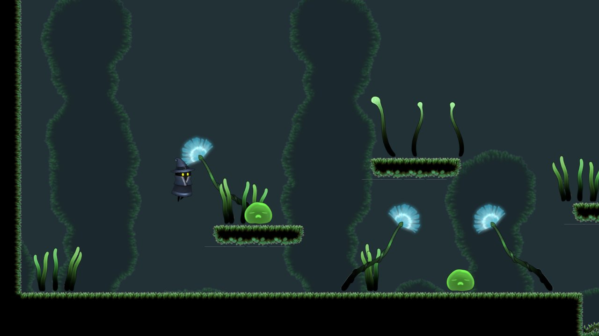

# Mosswake

Jeu de plateforme/action 2D **multijoueur en réseau local** (UDP), en Rust + Bevy, dans un monde moussu.
Chaque niveau peut embarquer des **scripts Rhai** qui transforment ses mécaniques (gravité inversée,
lave montante, modes de jeu multijoueur…). Un **éditeur de niveaux** est inclus et exposé aux agents IA via **MCP**.

> 🚧 En construction — le projet est développé par des agents IA. Voir les [issues](https://github.com/ayteyssi/mosswake/issues).

- Agents : lire [`CLAUDE.md`](CLAUDE.md) puis [`CONTRIBUTING.md`](CONTRIBUTING.md).
- Architecture : [`docs/ARCHITECTURE.md`](docs/ARCHITECTURE.md).



```sh
cargo run -p mosswake -- play tutorial # solo local (clavier ou manette)
cargo run -p mosswake -- play tutorial --autoplay --screenshot shot.png --at 3   # démo + capture
cargo run -p mosswake -- host          # (à venir)
cargo run -p mosswake -- join 192.168.1.10
```
